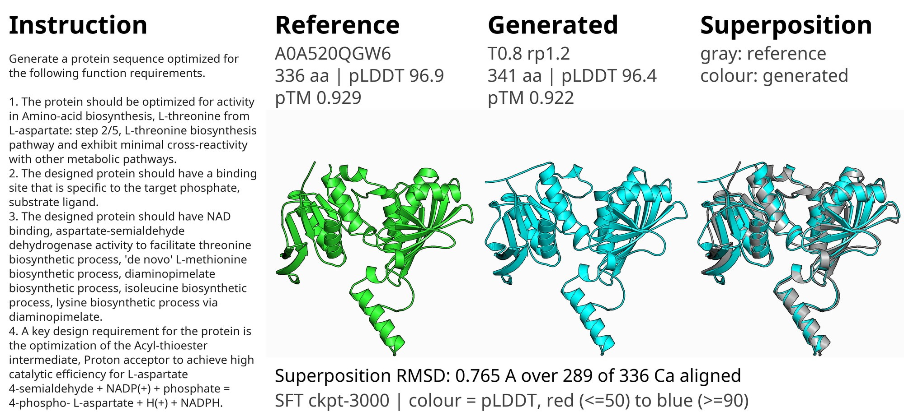
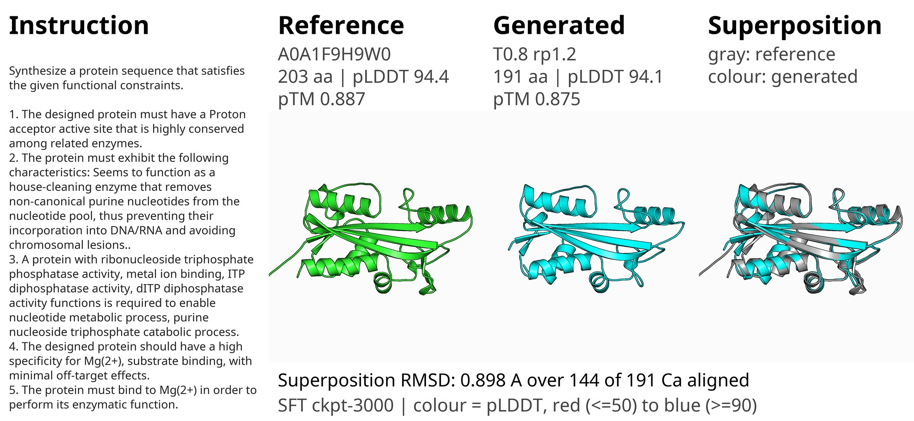
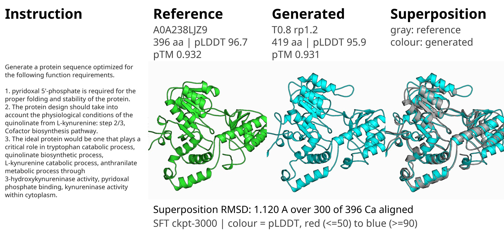
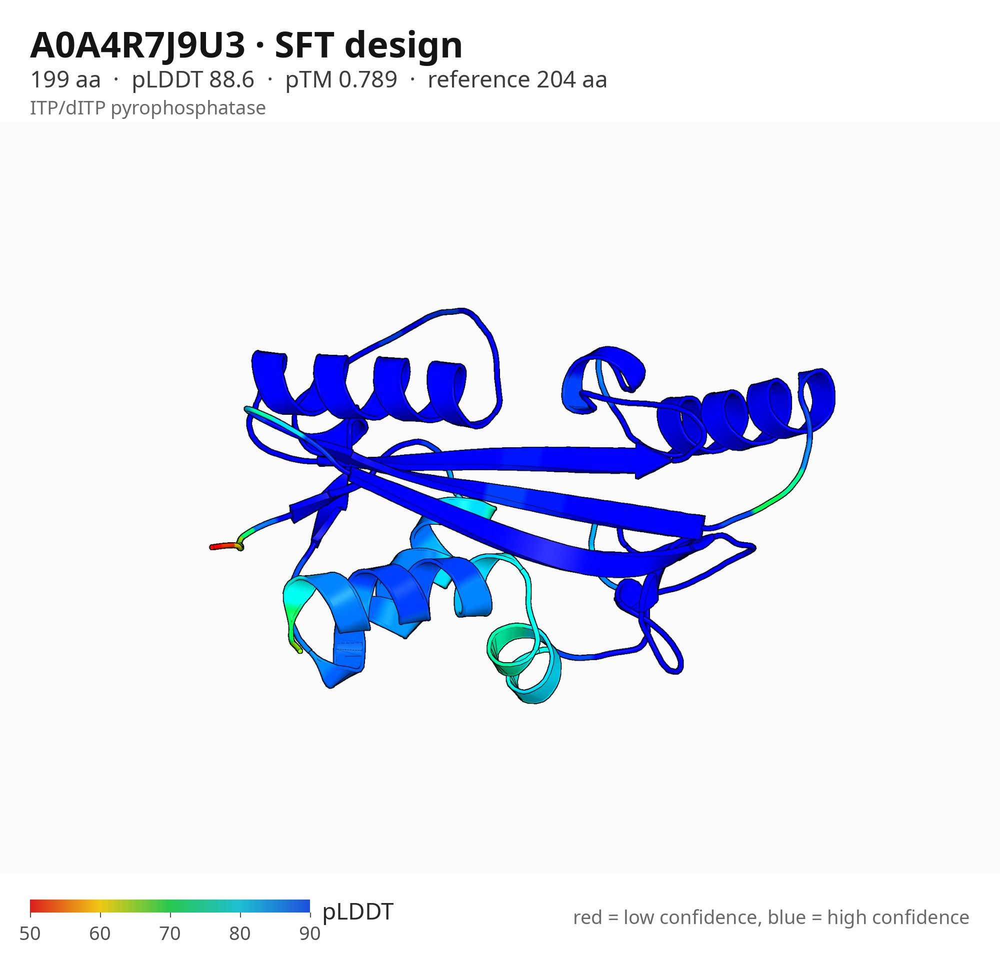
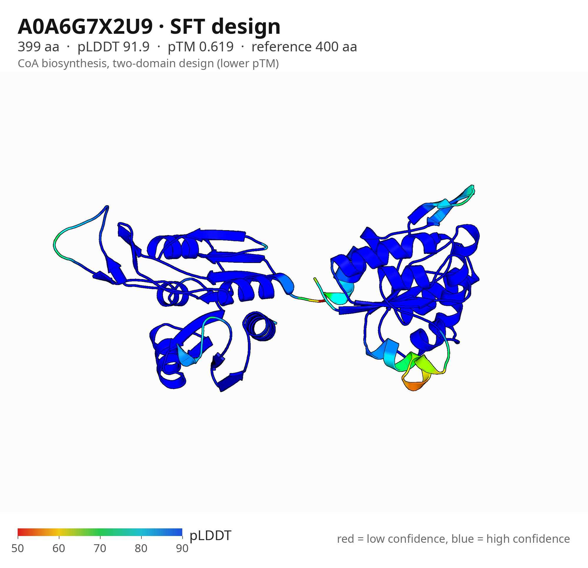
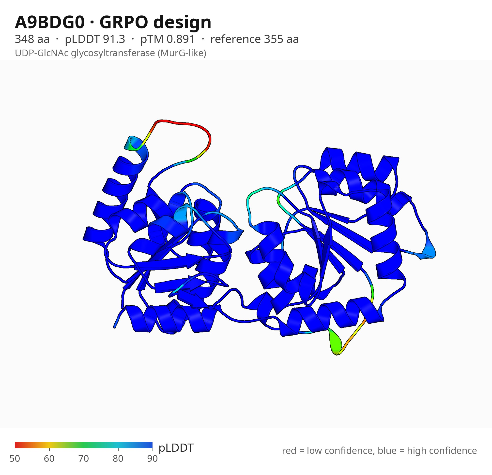
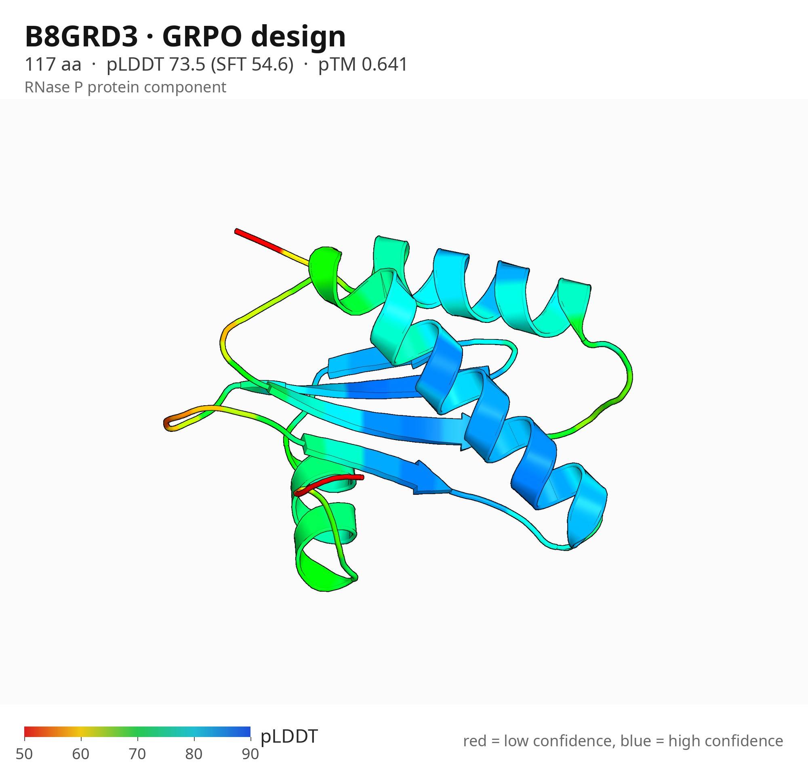

# Barca

**Barca** is a protein language model family and training toolkit named after
the Barcid family of Carthage — most famously **Hannibal Barca**.

This repository fine-tunes [`khairi/barca-0.8b-base`](https://huggingface.co/khairi/barca-0.8b-base),
a Qwen3.5-based decoder-only LM, for **protein sequence design**: from
causal-language-modeling pretraining to instruction-conditioned SFT, reward-based
GRPO refinement, sampling, and fold-based evaluation. Runs are driven by YAML
recipes, with full fine-tuning, LoRA, QLoRA, selective token training,
top-k checkpointing, and W&B logging.

The model's tokenizer adds 22 protein tokens at ids **248077–248098**: the 20
ζ-prefixed amino acids (`ζA`…`ζY`) plus `<protein>` and `</protein>`.

**Released model:** [`khairi/barca-0.8b-sft-design`](https://huggingface.co/khairi/barca-0.8b-sft-design)
· **Release write-up:** [Designing proteins with a 0.8B language model](docs/blog/barca-protein-design-release.md)

---

## Design showcase

Instruction-conditioned designs from
`outputs/barca-0.8b-sft-design/checkpoint-3000`, sampled at temperature 0.8.
Each panel shows the Mol-Instructions reference structure, the generated design,
and their CA superposition. Structures were predicted with ColabFold
(AlphaFold2) from the public MSA server; colour in the right-hand panels is
per-residue pLDDT.

<p align="center">
  <a href="docs/showcase/design-A0A520QGW6.jpg">
    
  </a>
</p>

<p align="center">
  <a href="docs/showcase/design-A0A1F9H9W0.jpg">
    
  </a>
  <a href="docs/showcase/design-A0A238LJZ9.jpg">
    
  </a>
</p>

| Target | Function (prompt summary) | Reference | Design | pLDDT | pTM | CA-RMSD |
|---|---|---|---:|---:|---:|---:|
| `A0A520QGW6` | aspartate-semialdehyde dehydrogenase, L-threonine biosynthesis | 336 aa | 341 aa | **96.4** | **0.922** | **0.765 Å** (289/336) |
| `A0A1F9H9W0` | ITP/dITP diphosphatase, purine house-cleaning | 203 aa | 191 aa | **94.1** | **0.875** | **0.898 Å** (144/191) |
| `A0A238LJZ9` | kynureninase, PLP-dependent tryptophan catabolism | 396 aa | 419 aa | **95.9** | **0.931** | **1.120 Å** (300/396) |

Generated sequences and per-design metadata are in
[`docs/showcase/designs.fasta`](docs/showcase/designs.fasta). These are
computational designs scored by predicted structure only; they have **not** been
expressed or assayed in a wet lab.

### More designs, coloured by pLDDT

These additional designs are single-model predictions, coloured by per-residue
pLDDT (red ≤ 50, blue ≥ 90). The first two come from the SFT design model; the
last two are GRPO candidates from the same prompts, shown to illustrate the
reward-based refinement stage.

<p align="center">
  <a href="docs/showcase/plddt-A0A4R7J9U3.jpg">
    
  </a>
  <a href="docs/showcase/plddt-A0A6G7X2U9.jpg">
    
  </a>
</p>
<p align="center">
  <a href="docs/showcase/plddt-A9BDG0-grpo.jpg">
    
  </a>
  <a href="docs/showcase/plddt-B8GRD3-grpo.jpg">
    
  </a>
</p>

| Design | Source | Target | Length | pLDDT | pTM | Note |
|---|---|---|---:|---:|---:|---|
| `A0A4R7J9U3` | SFT ckpt-3000 | ITP/dITP pyrophosphatase | 199 aa | 88.6 | 0.789 | compact α/β domain |
| `A0A6G7X2U9` | SFT ckpt-3000 | CoA biosynthesis, two-domain enzyme | 399 aa | 91.9 | 0.619 | high pLDDT, less confident domain arrangement |
| `A9BDG0` | GRPO ckpt-3000 | UDP-GlcNAc glycosyltransferase (MurG-like) | 348 aa | 91.3 | 0.891 | redesign of a 355-aa reference |
| `B8GRD3` | GRPO ckpt-3000 | RNase P protein component | 117 aa | 73.5 | 0.641 | SFT candidate folded at 54.6 pLDDT |

Predictions use ColabFold (AlphaFold2) with the full 20-loop/100-step setting.
The pLDDT colour scale is the same in every panel; pTM is reported separately
because a confident local fold can still have an uncertain domain arrangement
(visible for `A0A6G7X2U9`).

---

## Features

- **YAML recipes** (`configs/`) for SFT, LoRA/QLoRA, calibration, and GRPO.
- **Full / LoRA / QLoRA** training selected with a single flag.
- **Instruction-conditioned protein design** from Mol-Instructions, using the
  model's chat template and ζ-prefixed protein tokens.
- **GRPO** with a reward suite: binary format, flat ESMFold2 pLDDT bands,
  and a reference-length band reward.
- **Selective token training**: freeze everything except chosen embedding rows
  and the tied `lm_head` (used to learn the added protein tokens).
- **Top-k checkpointing**: keep only the best `k=3` checkpoints by evaluation
  loss; evaluation and saving share a cadence.
- Tokenization, packing, generation, filtering, and folding utilities.
- W&B logging; multi-GPU via `torchrun`; datasets loaded with
  `datasets.load_from_disk`.

---

## Layout

```
barca/
├── configs/                       # training recipes + generation settings
│   ├── full_ft.yaml
│   ├── lora.yaml
│   ├── qlora.yaml
│   ├── calibration_ft.yaml
│   ├── sft_design.yaml
│   ├── sft_design_continue_2e-6.yaml
│   ├── grpo.yaml
│   └── generation/                # sampling configs (not --config inputs)
├── docs/
│   ├── lora_2m_findings.md        # LoRA 2M experiment notes
│   ├── grpo_recipe.md             # GRPO design notes and acceptance criteria
│   ├── blog/                      # release write-up
│   └── showcase/                  # design figures + FASTA
├── scripts/
│   ├── training/
│   │   ├── train.sh               # SFT launch (single GPU / torchrun)
│   │   └── train_grpo.py          # GRPO entry point
│   ├── data/
│   │   ├── inspect_dataset.py     # schema + sequence-length stats
│   │   ├── split_dataset.py       # (re)build train/validation/test splits
│   │   ├── preprocess.py          # tokenize/pack offline -> DatasetDict
│   │   └── prepare_mol_instruct_design.py  # Mol-Instructions -> chat SFT data
│   ├── generation/
│   │   ├── generate.py            # prompt continuation / diagnostics
│   │   ├── generate_fasta.py      # sample sequences from checkpoints
│   │   ├── gen_best_sft_design.py # instruction -> design + reference JSON
│   │   ├── gen_grpo_candidates.py # GRPO candidate generation
│   │   ├── filter_proteins.py     # keep valid/foldable sequences
│   │   └── fold_plddt.py          # ESMFold + mean pLDDT
│   ├── eval/
│   │   ├── ntp/                   # next-token loss/perplexity eval
│   │   ├── gsm8k_cot_pot.py       # text-capability check
│   │   ├── prepare_changed_fold_input.py
│   │   └── compare_grpo_sft_folds.py
│   └── serving/
│       ├── esmfold2_service.py    # local ESMFold2 pLDDT/pTM reward service
│       └── smoke_fold_wandb.py
├── src/barca/
│   ├── config.py                  # typed recipe parsing
│   ├── data/                      # loading.py, processing.py
│   ├── modeling/                  # loading, PEFT, selective token training
│   ├── rl/                        # GRPO dataset + reward functions
│   ├── training/                  # run.py, CLI, arguments, callbacks
│   └── utils.py
└── tests/                         # 42 unit tests
```

---

## Setup

The training environment is expected to provide the runtime libraries (torch,
transformers, datasets, peft, accelerate, wandb, …). To make the package
importable:

```bash
pip install -e .             # core deps
pip install -e ".[qlora]"    # + bitsandbytes
pip install -e ".[flash]"    # + flash-attention (optional)
pip install -e ".[rl]"       # + TRL/httpx for GRPO
pip install -e ".[serving]"  # + FastAPI service for the foldability reward
```

The launch scripts prepend `src/` to `PYTHONPATH`, so
`python -m barca.training ...` also works from a fresh checkout. CUDA is
required: the model uses FLA Triton kernels and CPU execution fails.

---

## Quickstart

```bash
# SFT / LoRA / QLoRA (single GPU)
./scripts/training/train.sh configs/lora.yaml

# Full fine-tune with an explicit output directory, no W&B
./scripts/training/train.sh configs/full_ft.yaml \
    --output_dir runs/barca-full-ft-1 --run_name barca-full-ft-1 --no_wandb

# Multi-GPU
NUM_GPUS=4 ./scripts/training/train.sh configs/qlora.yaml

# Resume
./scripts/training/train.sh configs/lora.yaml \
    --resume_from_checkpoint outputs/barca-0.8b-lora/checkpoint-800

# Direct invocation
python -m barca.training --config configs/lora.yaml

# Smoke test any recipe
python -m barca.training --config configs/full_ft_smoke.yaml \
    --max_steps 200 --no_wandb --set gradient_checkpointing=false
```

`--set KEY=VALUE` patches a single `transformers.TrainingArguments` field. It
does not patch `data`, `model`, or `peft`.

A `Makefile` wraps the remote workflow (`make sync`, `make smoke`,
`make train RECIPE=...`, `make inspect`, `make pull checkpoint-1000`). Copy
`Makefile.local.example` to `Makefile.local` to set the SSH host and data paths.

---

## Data

Training data is any dataset written with `datasets.save_to_disk` and loadable
with `datasets.load_from_disk`. Two layouts are supported:

- **Split root** — one dataset subdirectory per split, e.g.
  `/data/proteins/barca_5m/{train,valid}`. Names come from `data.train_split`,
  `data.eval_split`, and `data.test_split`.
- **Single root** — one directory holding a `DatasetDict` or a single `Dataset`
  (split in memory with `data.eval_fraction` / `data.test_fraction`).

Tokenization is detected **per split**. In `barca_5m`, `train` is pre-tokenized
and pre-packed at length 515 while `valid` is raw, so keep
`data.packing: false`. Pre-tokenized splits are passed through untruncated;
`data.max_seq_length` does not apply, and the collator pads each batch to its
longest row. A single long row can therefore OOM a micro-batch — smoke-test
with `--max_steps 2` first.

Inspect a dataset before training:

```bash
python scripts/data/inspect_dataset.py /data/proteins/barca_5m
```

For raw sequence data:

```bash
python scripts/data/inspect_dataset.py /data/proteins/raw \
    --column sequence --tokenizer khairi/barca-0.8b-base
python scripts/data/split_dataset.py /data/proteins/raw \
    --output /data/proteins/processed \
    --eval-fraction 0.02 --test-fraction 0.02 --seed 42
./scripts/data/preprocess.sh configs/lora.yaml --output /data/proteins/tokenized
```

### Protein-design SFT data

`scripts/data/prepare_mol_instruct_design.py` converts the **protein_design**
subtask of [Mol-Instructions](https://huggingface.co/datasets/zjunlp/Mol-Instructions)
into chat conversations:

```
user:       <instruction>\n\n<input>
assistant:  <prose>\n<protein>ζMζIζ...</protein>
```

Validation is split by protein accession, so the same protein never appears in
both splits. Note that the training collator rebuilds labels from `input_ids`
and ignores a precomputed `labels` column, so the default loss covers the whole
conversation (question + answer), not only the assistant turn.

```bash
python scripts/data/prepare_mol_instruct_design.py \
    --json /data/mol-instruct/raw/protein/Protein-oriented_Instructions/protein_design.json \
    --tokenizer outputs/barca-0.8b-calibration-ft \
    --output /data/mol-instruct
```

---

## Selective token training

To fine-tune **only** the protein-token embeddings and leave every other weight
frozen, set one of the `model.trainable_*` options:

```yaml
model:
  trainable_token_range: [248077, 248098]   # inclusive token-id range
  # or: trainable_tokens: ["<protein>", "</protein>", "ζA", ...]
  # or: trainable_token_ids: [248077, 248078, ...]
```

All parameters are frozen; only the selected rows of the input embedding (and
the tied `lm_head`) receive gradients.
`RestoreFrozenEmbeddingRowsCallback` restores the non-selected rows from a
snapshot after each optimizer step, so weight decay decays only the selected
rows instead of the whole vocabulary matrix.

---

## GRPO

`scripts/training/train_grpo.py` continues an SFT design checkpoint with TRL's
`GRPOTrainer` and **full fine-tuning** (`G=8`, lr `3e-6`, cosine schedule).
Completions are scored by `src/barca/rl/rewards.py`:

| Reward | What it measures |
|---|---|
| `format` | binary: one closed `<protein>` block with ζ-prefixed canonical AAs |
| `foldability` | flat pLDDT bands: `<50` −1.0, `50–70` −0.5, `70–90` +0.5, `≥90` +1.0 |
| `length` | piecewise band around the reference length |

Invalid outputs get foldability `−2.0`; the service scores valid sequences from
10 to 1024 aa. Start the service on a GPU host, then run GRPO:

```bash
python scripts/serving/esmfold2_service.py --host 127.0.0.1 --port 8010
PYTHONPATH=src python scripts/training/train_grpo.py --config configs/grpo.yaml
```

`docs/grpo_recipe.md` documents the prompt selection, reward weights, anti-reward-hacking
checks, evaluation recipe, and acceptance criteria. The foldability service is
new and experimental; run the smoke test before a long job.

---

## Generation and folding

```bash
# Sample from one or more checkpoints
python scripts/generation/generate_fasta.py outputs/barca-0.8b-full-ft/checkpoint-* \
    --num-samples 10 --output proteins.fasta

# Instruction -> designed sequence + reference, for fold comparison
python scripts/generation/gen_best_sft_design.py \
    outputs/barca-0.8b-sft-design/checkpoint-3000 designs.json

# Keep plausible sequences, then fold
python scripts/generation/filter_proteins.py proteins.fasta filtered.fasta --max-len 400
python scripts/generation/fold_plddt.py filtered.fasta --out-dir pdbs
```

`configs/generation/*.yaml` holds sampling settings (temperature, top-p, top-k,
repetition penalty). They are **not** valid `--config` inputs. When comparing
checkpoints, pass settings explicitly: the scripts' defaults differ. The
config used for the showcase is
[`configs/generation/sft_design_best.yaml`](configs/generation/sft_design_best.yaml)
(T 0.8, top-p 0.95, top-k 50, repetition penalty 1.2).

Caveats:

- `filter_proteins.py` does **not** detect tandem repeats. Low-complexity
  LRR/TPR/ankyrin-like proteins can pass the filters and still score a high
  pLDDT — check for repeats before calling a structure a candidate.
- Folding with the public ColabFold MSA server can sit `PENDING` for many
  minutes; rerunning in the same directory resumes.
- One long FASTA row can dominate a batch; filter by length first.

---

## Evaluation

```bash
# Next-token loss / perplexity overall and per group from a CSV or save_to_disk dataset
python scripts/eval/ntp/evaluate.py --help
python scripts/eval/ntp/download_dataset.py --help

# Small text-capability check
python scripts/eval/gsm8k_cot_pot.py --help

# Pair GRPO and SFT designs by prompt/candidate and compare ColabFold pLDDT/pTM
python scripts/eval/compare_grpo_sft_folds.py \
    --sft-json sft.json --grpo-json grpo.json \
    --sft-folds sft_colabfold/ --grpo-folds grpo_colabfold/ \
    --reuse-identical --output comparison.json
```

---

## Checkpoint policy

`checkpointing.top_k: 3` keeps the three checkpoints with the lowest
`eval_loss` (change `metric` / `greater_is_better` to alter this). Evaluation
and saving are forced to the same cadence (`save_steps == eval_steps`), and the
Trainer's own `save_total_limit` is disabled — `TopKCheckpointCallback` owns
retention. The best checkpoint is copied to `run.output_dir` at the end of
training. Checkpoints stay local; W&B receives metrics and config only.

---

## W&B

```bash
export WANDB_API_KEY=...
export WANDB_ENTITY=your-team   # optional
```

`wandb.project`, `wandb.entity`, `wandb.tags`, and `wandb.notes` come from the
recipe. Each run is tagged with a short config fingerprint (`cfg-XXXXXXXX`); the
resolved YAML is written to `output_dir/config.yaml` and uploaded. Pass
`--no_wandb` (or set `wandb.enabled: false`) to disable logging.

---

## Development

```bash
pytest -q          # 42 tests
ruff check .
```

`tests/test_config.py` only needs PyYAML. `tests/test_callbacks.py`,
`tests/test_data.py`, and the GRPO tests also need transformers/datasets. The
model tests need torch. Some exploratory `scripts/generation/sweep*_sft_design.py`
and `scripts/eval/gsm8k_cot_pot.py` scripts are intentionally terse and are not
ruff-clean; the library, trainer, RL, serving, and test code are.

---

## Notes

- The model is Qwen3.5-based (the “Llama-style” description in older revisions
  of this README is legacy). `model.attn_implementation` should be
  `flash_attention_2` only when flash-attn is installed; otherwise use `sdpa`
  or `null`.
- The GB10 server may also run long LoRA jobs. Any GPU/eval job of yours slows
  those down; coordinate before launching.
- Folding outputs live under the gitignored `data/gen/`; the curated figures in
  `docs/showcase/` are the small, committed subset.

## License

MIT. See [LICENSE](LICENSE).
