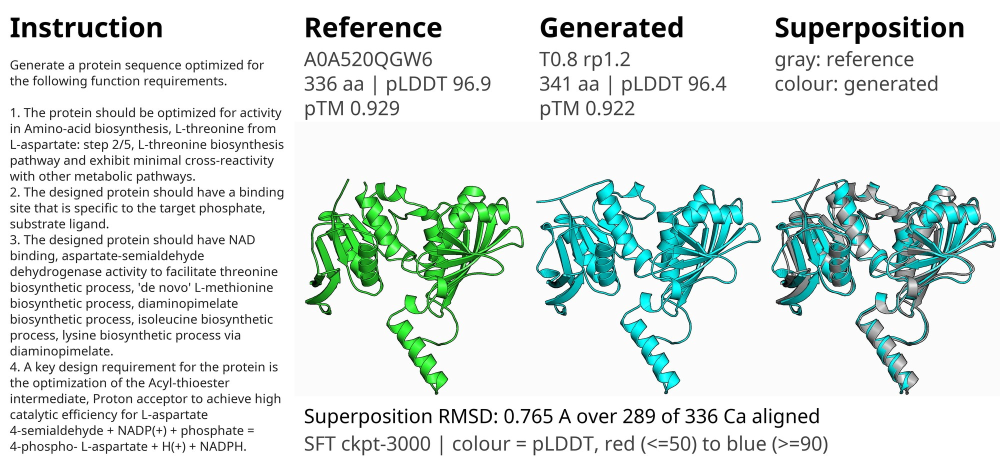

# Designing proteins with a 0.8B language model

**Releasing Barca-0.8B SFT Design: the training pipeline, the evaluation, and what the model can and cannot do.**

*Published 2026-11-22 · Khairi*

This post accompanies the release of **Barca-0.8B SFT Design**, a
752M-parameter language model that turns a natural-language protein-design brief
into an amino-acid sequence.

- Weights: [`khairi/barca-0.8b-sft-design`](https://huggingface.co/khairi/barca-0.8b-sft-design)
- Code and recipes: [`abidikhairi/barca`](https://github.com/abidikhairi/barca)
- Base model: [`khairi/barca-0.8b-base`](https://huggingface.co/khairi/barca-0.8b-base)

It is a research model, not a validated protein-engineering tool. The best
outputs fold confidently *in silico* and often reproduce the overall topology of
the prompt's reference protein. The model also fails in predictable ways:
occasionally it ignores length, returns fragments, or produces sequences that
fold poorly. Both sides are worth documenting, so this post covers the full
pipeline rather than only the highlight reel.

---

## Why instruction-conditioned protein design?

Protein language models are usually trained to score or continue sequences. A
design model needs a different interface: it should read a specification —
“an aspartate-semialdehyde dehydrogenase for L-threonine biosynthesis, with a
phosphate-binding site” — and write a sequence that plausibly satisfies it.

Barca does this as ordinary next-token prediction over a chat conversation. The
answer is a short prose prefix followed by a protein block:

```
user:       Synthesize a protein sequence that ...
assistant:  The amino acid sequence for your custom protein design is
            <protein>ζMζGζFζKζI...</protein>
```

Two design choices matter here:

1. **Protein residues are their own tokens.** The tokenizer adds 20 ζ-prefixed
   amino acids (`ζA`…`ζY`) plus `<protein>` and `</protein>`. The ζ prefix keeps
   protein sequence tokens distinct from ordinary English letters and punctuation.
2. **The chat template is the condition.** The full instruction stays in context;
   the model learns to map functional, structural, and pathway descriptions onto
   sequences.

---

## The model

Barca is a Qwen3.5-family decoder, released here as a full fine-tune for protein
design.

| Property | Value |
|---|---|
| Architecture | `Qwen3_5ForCausalLM`, decoder-only |
| Parameters | 752M |
| Layers / hidden size | 24 / 1024 |
| Attention | 8 query heads, 2 KV heads; hybrid linear + full attention |
| Vocabulary | 248,099 tokens (248,044 base + 55 added) |
| Protein tokens | ids 248077–248098: 20 ζ-amino acids, `<protein>`, `</protein>` |
| Precision | full fine-tune in fp32, SDPA, gradient checkpointing |
| Design-SFT context | 2,048 tokens |

The released checkpoint is the result of a multi-stage recipe: continued
pretraining on proteins, a calibration pass to limit text forgetting,
instruction tuning, and a low-learning-rate continuation. A GRPO refinement stage
also exists in the repo but is not part of this weight release.

---

## Training pipeline

The pipeline was built around a simple constraint: a protein-only model is good
at proteins but bad at instructions, and an instruction-tuned text model has no
reason to emit valid protein sequences. Each stage adds one missing capability.

| Stage | Data | Trainable parameters | Peak LR | Result |
|---|---|---|---|---|
| Base model | — | — | — | general-purpose Qwen3.5 decoder |
| Protein-token embeddings | 1M UniRef50 sequences | 22 embedding rows + tied head | 1e-3 | protein tokens are no longer random |
| LoRA continued pretraining | 2M UniRef50 sequences | LoRA r=64 | 5e-5 | protein LM adaptation |
| Calibration | 85.5k protein + text rows | full model | 2e-6 | limit text forgetting |
| Design SFT | 190k Mol-Instructions rows | full model | 2e-4 | instruction → protein |
| Low-LR continuation | 4,872 curated design examples | full model | 1e-6 | released checkpoint |

### 1. Learn the protein tokens first

The 22 protein tokens start from random embeddings. The first run trains
**only those rows** (and the tied `lm_head`) on a 1M-sequence UniRef50 subset at
LR 1e-3, leaving the transformer frozen. A `RestoreFrozenEmbeddingRowsCallback`
restores every non-selected vocabulary row after each optimizer step, so weight
decay applies only to the new rows. This avoids perturbing the pretrained text
model while giving the protein tokens a useful initial geometry.

### 2. Adapt the transformer with LoRA

The next stage adds LoRA adapters (r=64, alpha=128) to the attention and MLP
projections and trains on a random 2M subset of UniRef50 sequences, starting
from the embedding-only checkpoint. The run uses fp32, cosine decay from 5e-5 to
5e-6, 3% warmup, and 15,625 optimizer steps at a global batch of 128.

This is where the model becomes a protein language model rather than a text model
that happens to know protein tokens. The validation loss falls from 2.785 at the
embedding-only start to about 2.694 by step 12,000. The improvement is real but
slow, and the run is expensive: roughly 50 seconds per step on an idle GB10 and
90–100 seconds when the GPU is shared.

### 3. Calibrate against text forgetting

Training only on proteins has a cost. In the 2M LoRA run, Cosmopedia perplexity
rose from **5.995** for the base model to **8.71** at step 10,500 (+45%). The
model started leaking protein strings into unrelated prompts and lost some code
ability.

The calibration pass mixes protein and text: 85,500 rows, split evenly across
protein and eight Cosmopedia subsets, so about 4% of tokens are protein. It is a
full fine-tune at a constant 2e-6 for one epoch (668 steps at a global batch of
128). The repo includes the recipe as `configs/calibration_ft.yaml`; the result
is the `barca-0.8b-calibration-ft` checkpoint used as the starting point for
instruction tuning.

### 4. Instruction-tune on Mol-Instructions

The design stage uses the **protein_design** subtask of
[Mol-Instructions](https://huggingface.co/datasets/zjunlp/Mol-Instructions):
190,554 training rows and 2,000 validation rows, split by protein accession so
the same protein never appears in both splits. Each row is converted into the
model's chat format, with the amino-acid sequence rewritten as
`<protein>ζMζI…</protein>`.

The run is a full fine-tune in fp32, peak LR 2e-4 with cosine decay, global batch
128, and length-grouped batches. The released checkpoint comes from step 3,000,
not from the end of the 5-epoch schedule; its best validation loss was **1.3612**.

One implementation detail is worth flagging. The training collator rebuilds
labels from `input_ids`, so a precomputed assistant mask is ignored: the loss
covers the whole conversation, including the user prompt. That is not ideal for
instruction tuning, but it is what these checkpoints were trained with, and it
did not prevent the model from learning the output format.

### 5. Continue gently

The final released weights are a second, low-LR pass initialized from the
step-3,000 checkpoint. It uses a curated 4,872-example design set with 500
held-out validation examples, a fresh optimizer, cosine decay at LR **1e-6**, and
two epochs at batch 4 × 32. The final validation loss was **2.0732**.

The two validation numbers are not comparable: they use different data and
formats. The continuation is best read as a gentle adaptation, not a full retrain.
The exact release run is recorded in the model's `config.yaml` on the Hub; the
repo also keeps the full Mol-Instructions recipes and a second continuation
variant for reference.

### 6. GRPO (experimental, not released)

The repo adds a GRPO stage that continues an SFT checkpoint with a LoRA adapter.
Completions are scored by a multi-objective reward:

| Reward | Purpose |
|---|---|
| format | closed `</protein>`, canonical amino acids, 30–512 aa |
| reference 5-mer F1 | stay near the prompt's reference sequence |
| foldability | low-cycle ESMFold2 pLDDT from a local FastAPI service |
| diversity | penalize low-complexity and repeat collapse |
| length | stay near reference length |

The motivation is direct: SFT maximizes the likelihood of reference sequences,
while GRPO can optimize sequence validity and predicted foldability in the loop.
This stage is implemented and has been run at a small scale, but the GRPO
weights are not part of the release. Its early results are discussed below.

---

## How it was evaluated

### Sampling

Generation quality depends heavily on the decoding settings. A 500-prompt sweep
over checkpoint-3000 selected:

- temperature 0.8
- top-p 0.95
- top-k 50
- repetition penalty 1.2

In that sweep, **483 of 500** outputs emitted a closing `</protein>`, the median
closed output was **1.03×** the reference length, and unique 5-mers were **0.98**.
The runner-up (T 0.6) closed 443/500 outputs and had lower diversity. These
numbers are about format and sequence statistics, not folding.

### Folding

For a stricter check, we sampled ten validation prompts with references of at
most 400 aa, generated one design each, and folded both the reference and the
design with ColabFold (AlphaFold2) using the full 20-loop/100-step setting. The
results split cleanly:

| Target | Design length | pLDDT | pTM | CA-RMSD to reference |
|---|---:|---:|---:|---:|
| `A0A520QGW6` | 341 aa | 96.4 | 0.922 | 0.765 Å |
| `A0A1F9H9W0` | 191 aa | 94.1 | 0.875 | 0.898 Å |
| `A0A238LJZ9` | 419 aa | 95.9 | 0.931 | 1.120 Å |
| `A0A4R7J9U3` | 199 aa | 88.6 | 0.789 | 0.864 Å |
| `A0A6G7X2U9` | 399 aa | 91.9 | 0.619 | 5.178 Å |
| `B0UWV9` | 482 aa | 31.3 | 0.226 | failed |
| `Q86Y39` | 374 aa | 33.9 | 0.245 | failed |
| `Q30TC9` | 88 aa | 41.5 | 0.276 | failed |
| `O13942` | 130 aa | 48.8 | 0.259 | failed |
| `Q8AY51` | 16 aa | 63.6 | 0.030 | fragment |

Five of ten designs reached pLDDT > 88, and four of those also had pTM > 0.78.
For the strongest examples, the designed sequence adopts essentially the same
fold as the reference despite a different sequence. The failures are equally
informative: one output was a 16-aa fragment, one overshot the reference length
by 300 residues and did not fold, and several ignored the target family
altogether.

<p align="center">
  <a href="../showcase/design-A0A520QGW6.jpg">
    
  </a>
</p>

The figure shows the reference (left), the generated design (middle), and their
CA superposition (right). The design is 341 aa versus a 336-aa reference, with
0.765 Å CA-RMSD over 289 aligned residues.

More pLDDT-coloured examples, including GRPO candidates, are in the
[showcase](https://github.com/abidikhairi/barca/tree/main/docs/showcase).

### Early GRPO results are mixed

Two internal GRPO checkpoints were folded and paired against their SFT
baselines on the same prompts:

| Checkpoint | Paired candidates | SFT mean pLDDT | GRPO mean pLDDT | Δ | W / L / T |
|---|---:|---:|---:|---:|---:|
| 1,600 | 14 | 89.16 | 88.84 | −0.32 | 1 / 4 / 9 |
| 2,200 | 14 | 87.72 | 88.14 | +0.42 | 2 / 3 / 9 |

The aggregate change is small and the paired sample is small. The interesting
case is a single prompt: for the RNase P protein component `B8GRD3`, the SFT
candidate folded at 54.6 pLDDT and the GRPO candidate at 73.5. That is the kind
of local repair the foldability reward was meant to produce. It is not yet
evidence that GRPO reliably improves design quality — only that the reward can
move a bad candidate in the right direction.

---

## What worked, and what did not

**Worked**

- The staged recipe produces valid, well-formed protein outputs from free-text
  instructions. Format validity is high under the chosen sampling settings.
- Several designs recover the reference fold with high confidence: pLDDT 94–96,
  pTM 0.88–0.93, and sub-ångström to ~1 Å CA-RMSD.
- The low-LR continuation and the calibration pass make the model usable without
  retraining from scratch.

**Did not work reliably**

- **Length control.** The model sometimes returns a fragment or a much longer
  sequence. `Q8AY51` produced 16 aa for an 86-aa reference; `B0UWV9` produced
  482 aa for a 183-aa reference.
- **Family selection.** Roughly half the folded prompts missed the target fold.
  The model is a proposal generator, not an oracle.
- **Repeat artefacts.** The sequence filter does not catch tandem repeats.
  Low-complexity LRR/TPR/ankyrin-like proteins can score high pLDDT without being
  useful designs. The showcased candidates were checked for 5-mer uniqueness and
  tandem identity, but this should be part of any downstream pipeline.
- **Novelty is unverified.** No BLAST or Foldseek search was run. A confident
  fold is not evidence of a new protein family.
- **Text ability is fragile.** The 2M LoRA stage cost significant text
  perplexity; calibration is designed to reduce that damage, though a full
  post-calibration text evaluation is still future work. This is not a
  general-purpose chat model.

---

## The release

**Weights.** [`khairi/barca-0.8b-sft-design`](https://huggingface.co/khairi/barca-0.8b-sft-design)
contains the full fine-tuned model, tokenizer, chat template, generation config,
and the resolved training recipe. The model card documents the two-stage SFT
release run and includes a usage example.

**Code.** The [GitHub repository](https://github.com/abidikhairi/barca) contains
the training toolkit, YAML recipes, data preparation, generation, filtering,
folding, evaluation scripts, the GRPO implementation, the ESMFold2 reward
service, and 42 unit tests. The code is MIT-licensed; check the Hub model card
for the terms attached to the weights.

**Showcase.** Curated reference/design comparisons and pLDDT-coloured structures
are in [`docs/showcase/`](https://github.com/abidikhairi/barca/tree/main/docs/showcase),
with sequences and per-design metadata in
[`designs.fasta`](https://github.com/abidikhairi/barca/blob/main/docs/showcase/designs.fasta).

**Not released.** GRPO weights, the training datasets (UniRef50 and
Mol-Instructions are linked, not redistributed), and any experimental validation.
The ESMFold2 service code is released, but the folding model itself is an
external dependency.

### Using the model

```python
from transformers import AutoModelForCausalLM, AutoTokenizer

repo = "khairi/barca-0.8b-sft-design"
tokenizer = AutoTokenizer.from_pretrained(repo, trust_remote_code=True)
model = AutoModelForCausalLM.from_pretrained(
    repo, trust_remote_code=True, device_map="auto"
)

messages = [{
    "role": "user",
    "content": (
        "I need a new protein designed that meets the following requirements.\n"
        "- The protein must contain a TIR domain.\n"
        "- The protein must carry out NAD+ catabolic process."
    ),
}]
prompt = tokenizer.apply_chat_template(
    messages, tokenize=False, add_generation_prompt=True
)
inputs = tokenizer(prompt, return_tensors="pt").to(model.device)
output = model.generate(
    **inputs, max_new_tokens=512, do_sample=True,
    temperature=0.8, top_p=0.95,
)
print(tokenizer.decode(output[0][inputs["input_ids"].shape[1]:],
                       skip_special_tokens=True))
```

Generate several samples per prompt, parse the `<protein>` block, and fold the
candidates before trusting them. The model is stochastic; one sample is not a
design.

### Reproducing the pipeline

The repo exposes each stage as a recipe:

```bash
pip install -e ".[rl,serving]"

# Protein-token embeddings, LoRA continued pretraining, calibration, SFT
python -m barca.training --config configs/emb_1m_fp32.yaml
python -m barca.training --config configs/lora_2m_fp32.yaml
python -m barca.training --config configs/calibration_ft.yaml
python -m barca.training --config configs/sft_design.yaml

# Generation and folding
python scripts/generation/gen_best_sft_design.py \
    outputs/barca-0.8b-sft-design/checkpoint-3000 designs.json
python scripts/generation/filter_proteins.py designs.fasta filtered.fasta --max-len 400
python scripts/generation/fold_plddt.py filtered.fasta --out-dir pdbs

# GRPO (experimental)
python scripts/serving/esmfold2_service.py --host 127.0.0.1 --port 8010
PYTHONPATH=src python scripts/training/train_grpo.py --config configs/grpo.yaml
```

Training these runs requires CUDA; the model uses FLA Triton kernels, so CPU
execution fails.

---

## Limitations and responsible use

This is a **research prototype**, not a protein-engineering product.

- Outputs are computational proposals. None of the showcased sequences has been
  expressed, purified, or assayed.
- pLDDT and pTM are model confidence scores, not measurements of stability,
  function, expression, or safety.
- The model can reproduce or interpolate training-set sequences. No novelty
  screen was run, and no biosafety screen is built into the release.
- Protein design has dual-use potential. Use this model for research and
  prototyping with appropriate institutional review; do not deploy designed
  sequences without experimental validation and the relevant biosafety checks.

The useful mental model is: **a fast, instruction-following proposal generator
that needs a folding-and-filtering pipeline around it.** That is exactly how the
showcase was produced, and it is the workflow the repo is meant to support.

---

## Links

- Model: <https://huggingface.co/khairi/barca-0.8b-sft-design>
- Code: <https://github.com/abidikhairi/barca>
- Base model: <https://huggingface.co/khairi/barca-0.8b-base>
- Mol-Instructions: <https://huggingface.co/datasets/zjunlp/Mol-Instructions>
- GRPO design notes: [`docs/grpo_recipe.md`](../grpo_recipe.md)
- LoRA 2M findings: [`docs/lora_2m_findings.md`](../lora_2m_findings.md)

If you use the model or code, cite the repository and the model card. Feedback
and failing examples are especially welcome — the failure modes are the most
useful part of the dataset right now.
